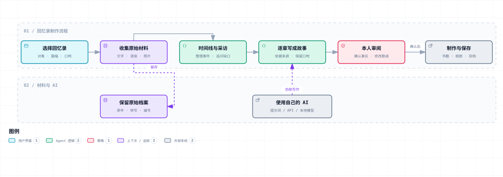

# Memory for Human

[简体中文](README.md) · [English](README.en.md) · [Español](README.es.md)

[GitHub 仓库](https://github.com/SkyPiggy8/memory-for-human) · [下载 ZIP](https://github.com/SkyPiggy8/memory-for-human/archive/refs/heads/main.zip)

**你讲故事，AI 帮你整理。把值得记住的人和事，留成一本回忆录。**

人的一生，由已经走过的经历与仍未抵达的未来共同构成。Memory for Human（MFH）希望用 AI 帮我们照顾那些真实发生过的生活：一次相遇、一段陪伴、一生的选择，还有只有你记得的细节。

MFH 现在是一个**可在本地操作的回忆录工具（v0.2）**。界面、采访问题、入门解释和 AI 交接说明支持中文、英文、西班牙语。API Key 使用者自行提供；没有 Key，也可以整理材料并交给平时使用的 AI。



上图是整体方向；语音文件自动转写、照片识别与相册/NAS 自动集成仍是后续计划。[交互流程图](docs/overview.html) · [技术说明](docs/architecture.md)

## 不知道这是什么？先这样理解

把它想成一个会帮忙整理的小本子。你写一段话、回答一个问题，或者把家人的话记下来。AI 只能依据这些内容，帮你写得连贯些。你检查后，留下文字，或者打印成书。

你只需要会两件事中的一种：**在页面里填自己的 API Key**，或**把“交给我的 AI”里的说明复制给平时使用的 AI**。不会操作的老人可以只负责讲，家人负责填写与核对。

页面里的「先看怎么用」会用日常语言解释用途、操作、Key、没有 Key 时的办法和资料去向。连接后，还可以让自己的 AI 再解释一次。

## 开始使用

### Windows：双击一个文件

1. 下载仓库并解压。
2. 双击 **`start.cmd`**。第一次若没有合适的运行环境，它会从 Node.js 官方网站下载并校验 LTS 版本，只放在本项目目录，不需要管理员安装。
3. 浏览器打开本地页面。保持启动窗口运行；关闭窗口即可停止服务。
4. 右上角选语言。点击「开始我的回忆录」，或先试一个明确标为虚构的示例。

本机默认地址为 `http://127.0.0.1:4317`。首次准备运行环境需要联网；以后填写、整理与备份可以不联网。下载失败时，把 [AI 交接说明](AI-HANDOFF.md)交给能操作电脑的 AI，让它协助。

### macOS / Linux

让自己的 AI 按 [AI 交接说明](AI-HANDOFF.md)准备 Node.js 22 或以上，再运行 `sh start.sh`。熟悉命令行的人也可直接运行：

```sh
node server.mjs
```

只想先看看或填写？也可双击 `index.html`。**直接打开文件时不提供 API 连接**，但可以填写、导入文字、编辑、导出和备份。文件模式与本地网页是不同的浏览器保存位置，切换前先下载备份，再导入。

## 四步完成一章

1. **选一种回忆录。** 取名字，写明讲述者、读者，决定先写一章还是慢慢写长篇。
2. **把故事讲出来。** 一次一个问题。直接输入、使用支持的浏览器语音输入，或导入文字材料。答案可以修改。
3. **整理成章节。** 连接 AI 写一章；也可把已有文字放在一起，或贴入自己 AI 写好的章节。逐章修改、检查、标为本人已审阅。
4. **保存与制作。** 下载完整文字备份、Markdown 文稿，或打开打印窗口另存为 PDF。按制作清单打样、装订与保存。

填写内容保存在这台设备的浏览器中。可以新建多本、切换、恢复备份。**浏览器存储不是唯一备份**，重要内容请下载项目文件并保留独立副本。

## 用自己的 AI

| 方式 | 你需要做什么 | 能做什么 |
| --- | --- | --- |
| 填 API Key | 选 Key 所属服务，在本地窗口填写 | 连接测试、继续采访、逐章写作、检查稿件、解释用法 |
| 平时使用的 AI | 复制交接说明，选择是否附上材料，再交给自己的 AI | 手动继续采访、写作与审阅，把结果贴回本项目 |
| 能操作电脑的 AI | 交给它仓库与 [AI-HANDOFF.md](AI-HANDOFF.md) | 按实际文件启动、配置，教你如何操作 |
| 本地模型 | 在其他选项中填本机兼容接口和模型名称 | 通过本地接口处理文字；运行环境自行准备 |

界面提供 OpenAI、DeepSeek、Claude、豆包及其他兼容服务的配置。默认值可以改；**Key 的权限、余额和模型可用性以你的账号为准**。预设接口已按官方资料实现并用模拟响应测试，尚未用使用者的真实 Key 做服务商逐一实测。[接口依据与验证范围](docs/api-reference.md)

网页版聊天账号与 API 是两个入口。不会配置模型名称或服务地址，可以让自己的 AI 按交接说明协助；不要把真实 Key 写进聊天、作品、交接包或公共仓库。Key 默认只留在本机服务本次运行的内存里。

## 六类故事，用不同的结构

以下为中文写作参考。英文、西班牙语根据实际材料调整，不强制对应字数，也不靠重复或虚构凑长度。

| 回忆录 | 建议结构 | 中文篇幅参考 |
| --- | --- | --- |
| [恋人](templates/lovers.md) | 相遇 → 靠近 → 日常 → 转折 → 想对你说 | 3,000–15,000 字 |
| [婚姻与家庭](templates/marriage.md) | 相识 → 共同决定 → 婚礼 → 家庭 → 一起成长 | 8,000–30,000 字 |
| [老人一生](templates/life-story.md) | 童年 → 求学 → 工作 → 家庭 → 转折 → 晚年 → 后人 | 30,000–80,000 字，逐章完成 |
| [战友](templates/comrades.md) | 初见 → 共同生活 → 难忘经历 → 分别 → 后来的联系 | 8,000–30,000 字 |
| [同事](templates/colleagues.md) | 加入 → 合作 → 关键时刻 → 成长 → 告别 | 5,000–20,000 字 |
| [同学](templates/classmates.md) | 入学 → 日常 → 集体时刻 → 毕业 → 再相逢 | 5,000–20,000 字 |

老人长篇适合分成约 10–16 章，每次只聊一个主题，累了就停。当前支持多章节、保存与继续填写；不会一键凭空生成几万字的人生。第一版可以先验证「恋人短篇」与「老人一章试读」。

## 材料怎样交进来

- **直接填写：** 在问题下面回答，家人可以代记录。
- **已有文字：** 导入 UTF-8 `.txt`、`.md`、`.csv`、`.json`，每份不超过 1 MB。当前按文字读取，不承诺每个平台聊天格式自动适配。
- **录音：** 先用自己的工具转写并校对，再导入文字。页面的语音输入依赖浏览器支持，可能联网；不是上传音频文件的 ASR。
- **照片：** 把人物、时间、地点、故事写成说明。保留照片原件；当前不识别图片、PDF 或手写信。
- **完整备份：** 从「下载完整文字备份」得到 `.mfh.json`，导入会创建一本新回忆录，不覆盖原来那本。

新导入的材料默认**不交给 AI**，可以逐份勾选。答案也可按章取消或勾选。AI 处理时使用勾选的答案与材料，以及任务所需的章节。材料过多会提示拆分，不悄悄截掉整个人生。[详细采集指南](docs/collection.md)

## 真实性与隐私

AI 整理已有经历、提问和润色，不能替人填造事实。工作稿保留 `[A1]`（采访答案）、`[M1]`（勾选材料）等来源标记；检查疑点后由本人决定最终版本。修改章节会将其重新标为草稿。

本地页面不等于所有处理都离线。调用在线 AI 或把交接包粘贴给在线工具，所选文字就会交给该服务。采访、聊天和照片的采集与分享范围请先取得相关人同意。[隐私说明](docs/privacy.md)

完整文字备份包含本项目的回答、导入文字、草稿与未提交的回答，不包含 API Key、原始照片和音频文件。原件请另行保存。

## 从故事到纪念物

| 成品 | 最简单的路径 |
| --- | --- |
| 纸质回忆录 | 审阅 → 下载文稿 → 向图文店问规格 → 排版成 PDF → 打样一本 → 校对与装订 |
| 照片书 | 选原图 → 附真实说明 → 排版 → 检查裁切 → 打样 |
| 数字相册 / 相框 | 先在闲置平板上展示照片与故事卡，再决定是否买专用硬件 |
| 家庭档案 / NAS | 本机资料 + 独立副本；有需要再用 NAS，并做恢复检查 |

[制作清单](docs/production-checklist.md)包括 BOM、询价话术、打印与装订步骤。[延伸工具](docs/ecosystem.md)链接语音转写、照片管理、硬件相框与文档归档项目，当前没有自动集成它们。

## AI 怎么接手这个项目

页面里的「交给我的 AI」会按任务与语言生成说明。默认不附私人材料；勾选后才加入已保存答案与选中材料。可以复制或下载 Markdown，再把 AI 的普通章节文字或约定 JSON 粘贴回来。

仓库同时提供 [中文](AI-HANDOFF.md)、[英文](AI-HANDOFF.en.md)、[西班牙语](AI-HANDOFF.es.md)交接文档，供能读取文件或操作电脑的 AI 使用。[AGENTS.md](AGENTS.md)说明真实文件、启动方式、验证要求与能力边界。

## 当前能力与后续计划

**已实现：** 三语界面与问题、低门槛解释、AI 交接、六类场景、文字材料、浏览器语音输入（需支持）、多本回忆录、本机保存、编辑章节、API 调用路径、备份恢复、Markdown 导出、浏览器打印。

**待实现：** 上传音频 ASR、图片/OCR、平台专属聊天适配、自动图文排版、自动 NAS/相册衔接、长篇检索与多人冲突审阅。[开发计划](docs/roadmap.md)

无需安装前端依赖；本机服务仅使用 Node.js 内置能力。开发验证：`npm test`。[贡献说明](CONTRIBUTING.md) · [GitHub 发布配置](docs/github-publishing.md)

## 使用许可

[PolyForm Noncommercial 1.0.0](LICENSE)：允许许可范围内的非商业使用、修改与分发，禁止未经另行授权的商业使用。你的私人材料与作品不因此被要求公开；第三方工具遵循各自条款。图示查看器等第三方内容见 [THIRD_PARTY_NOTICES.md](THIRD_PARTY_NOTICES.md)。
