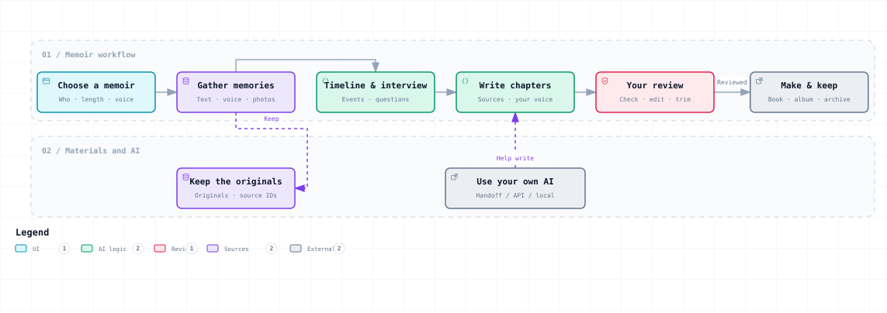

# Memory for Human

[简体中文](../../README.md) · [English](README.en.md) · [Español](README.es.md)

[GitHub repository](https://github.com/SkyPiggy8/memory-for-human) · [Download ZIP](https://github.com/SkyPiggy8/memory-for-human/archive/refs/heads/main.zip)

**You tell the story. Your AI helps organize it. Keep the people and moments you want to remember.**

Our lives are shaped by what we have lived and what is still ahead. Memory for Human (MFH) uses AI to help preserve real memories: a meeting, years together, important choices, and the details only you remember.

MFH is now a **working local memoir workspace (v0.2)**. The interface, interview questions, simple explanations, and AI handoff instructions are available in Chinese, English, and Spanish. Bring your own API Key, or use the AI you already talk to without connecting an API.



This diagram shows the overall direction. Audio-file transcription, image recognition, and automatic album/NAS integrations remain future work. [Interactive diagram (Chinese viewer)](../overview.html) · [English practical guide](guide.en.md#usage)

## New to all this?

Think of a notebook with a helper. You write a memory, answer a question, or record a relative’s words. AI can make those words easier to read, using only what you provide. You check the result, then save or print it.

You only need one of two paths: **put your own API Key into the connection window**, or **copy “Use my own AI” instructions into the AI you already use**. Relatives can handle the computer while an older family member tells the story.

“How it works” explains the tool, the Key, the no-Key route, and where your text goes in everyday language. If connected, your AI can explain it again.

## Start locally

### Windows: double-click one file

1. Download and unzip the repository.
2. Double-click **`start.cmd`**. If a suitable runtime is missing, it downloads and verifies official Node.js LTS into this project folder, without a system-wide administrator installation.
3. A browser opens the local page. Keep the launch window running; closing it stops the service.
4. Pick a language at the top right. Start a memoir, or try the clearly labeled fictional example.

Default address: `http://127.0.0.1:4317`. First-time runtime preparation needs internet. Writing, organizing, and backups can then work offline. If preparation fails, give [the AI handoff guide](AI-HANDOFF.en.md) to an AI that can help with your computer.

### macOS / Linux

Have your AI follow [the handoff guide](AI-HANDOFF.en.md) to prepare Node.js 22 or later, then run `sh start.sh`. Experienced users can run:

```sh
node server.mjs
```

You can also double-click `index.html` for writing, text imports, editing, and exports. **Direct file mode cannot connect to APIs.** File mode and the local web address use separate browser storage locations; download a backup before moving, then import it.

## Four steps to a chapter

1. **Choose a memoir.** Name it, say whose story it is and who it is for, and choose a short start or a longer book.
2. **Tell your story.** Answer one question at a time. Type, use supported browser dictation, or import existing text. Answers stay editable.
3. **Make a chapter.** Use connected AI, gather your original words, or paste a chapter written by your usual AI. Edit, check, and mark it reviewed.
4. **Save and make.** Download a full text backup or Markdown, or use browser printing to save a PDF. Follow the making checklist for a physical book.

Work is saved in this device’s browser. You can create several memoirs, switch between them, and restore backups. **Browser storage is not your only backup**: download project files and keep a separate copy.

## Your AI, your choice

| Route | What you do | What it supports |
| --- | --- | --- |
| API Key | Choose its service and enter the Key locally | Connection test, follow-up questions, chapters, review, explanations |
| Your usual AI | Copy instructions, optionally include material, and paste results back | Manual interviews, writing, and review |
| AI with computer access | Give it this repository and [AI-HANDOFF.en.md](AI-HANDOFF.en.md) | Start the actual app, configure it, and teach you to use it |
| Local model | Enter a local compatible endpoint and model in extra options | Text processing through your separately installed local model |

Settings are provided for OpenAI, DeepSeek, Claude, Doubao, and compatible services. Defaults can be edited. Account access, credits, and model availability depend on your service. Adapters were implemented from official documentation and tested with simulated responses; they have **not been individually tested with users’ real Keys**. [Sources and test scope](../technical.md#api)

A chat website account and an API are different routes. Your AI can help with model or endpoint settings. Do not put a real Key in a chat, memoir, handoff package, or public repository. By default the local server keeps it only in memory for this run.

## Six kinds of memoir

| Kind | Suggested structure |
| --- | --- |
| Love story | Meeting → closeness → daily life → changes → words for your partner |
| Marriage and family | Meeting → shared decision → wedding → home → growing together |
| A life story | Childhood → education → work → family → turning points → later years → next generation |
| Friends in service | Meeting → shared days → experiences → goodbye → later contact |
| Workmates | Joining → collaboration → key moments → growth → goodbye |
| School friends | Arrival → daily life → group memories → graduation → meeting again |

The Chinese templates suggest about 3,000–15,000 characters for a love story and 30,000–80,000 for a life story. These are optional Chinese planning ranges, not equivalent English word quotas. Adjust length to the actual stories.

A longer life story may use roughly 10–16 chapters. Talk about one topic at a time and stop when tired. Multiple chapters and continuing later work now; one-click invention of a whole life does not. Begin with a short relationship story or one life-story chapter.

## Bring in material

- Answer directly, with a family member helping if needed.
- Import UTF-8 `.txt`, `.md`, `.csv`, or `.json` text, up to 1 MB per file. This reads text; it is not a universal chat-platform parser.
- For recordings, use your own transcription tool first and check the words. Browser voice input depends on browser support and may use internet; it is not audio-file ASR.
- For photos, add captions with people, time, place, and story. Keep the originals separately. Image, PDF, and handwriting recognition are not implemented.
- Import a `.mfh.json` made by the full text backup button. It creates a new memoir without replacing the old one.

New materials are **excluded from AI by default**. Select them individually; answers can also be selected or excluded for a chapter. AI tasks use selected answers, selected materials, and the chapter needed for the task. Excessive context is rejected with a request to split it, rather than silently dropping text. [Practical guide](guide.en.md#usage)

## Truth and privacy

AI helps express real experience; it must not invent it. Working drafts keep source markers such as `[A1]` for answers and `[M1]` for selected material. The narrator decides the final wording. Editing a reviewed chapter returns it to draft status.

A local page does not mean every step is offline. API requests or online-AI handoffs send selected text to that service. Get permission for interviews, chats, photos, and sharing.

A full text backup includes answers, imported text, drafts, and an unfinished answer. It excludes API Keys and original photo/audio files. Keep original media separately.

## Make something to keep

| Result | A simple path |
| --- | --- |
| Printed memoir | Review → download → ask a print shop for specifications → prepare PDF layout → one proof copy → check and bind |
| Photo book | Pick originals → add true captions → lay out → check cropping → proof |
| Digital album / frame | Try photos and story cards on an existing tablet before buying hardware |
| Family archive / NAS | Keep local material and independent backups; add NAS only when useful and test recovery |

[The English practical guide](guide.en.md#usage) covers materials, printing, privacy, and optional tools. Independent projects are referenced, not automatically integrated.

## Let another AI take over

“Use my own AI” generates instructions for the selected task and language. Private material is excluded unless you opt in. Copy or download the instructions, then paste ordinary chapter text or the documented JSON result back into the app.

Repository handoff documents: [Chinese](../ai-handoff.md#handoff), [English](AI-HANDOFF.en.md), [Spanish](AI-HANDOFF.es.md). [AGENTS.md](../../AGENTS.md) describes files, startup, verification, and limitations for coding assistants.

## The technical work

MFH focuses on **traceable sources, model-independent tasks, human review, and recoverable progress**. Answers and materials have stable IDs; only selected sources enter writing requests. Manual AI handoff and API use share task rules. Editing a reviewed chapter resets it to draft; restoring a backup adds a new project.

The buildless frontend and Node.js built-in server keep runtime dependencies small and credentials separate from the work. Six relationships, three languages, relatives helping record, and production instructions connect interviewing to a finished keepsake. [Technical design](guide.en.md#architecture) explains the data, request scope, review state, and long-manuscript limits.

StorySage emphasizes specialized agents; memoir uses structured records and context management. MFH emphasizes families starting with their own AI and keeping work they can continue. These projects share some principles; MFH's distinction is its combination of workflow and audience. [Reference projects and differences](guide.en.md#related-work)

Each language now has **156 starting questions**: partners 24, marriage 24, a life 48, service friends 20, workmates 20, classmates 20. AI follows concrete details before moving to another topic, one question at a time. [Interview guide](guide.en.md#interview)

## Implemented and planned

**Working:** three-language UI and questions, simple explanations, AI handoff, six themes, text material, browser dictation where supported, multiple memoirs, local saving, chapter editing, API adapters, backup/restore, Markdown, browser print.

**Planned:** uploaded-audio ASR, OCR/images, platform-specific chat import, automatic illustrated layouts, album/NAS integration, long-book retrieval, and multi-author conflict review.

There are no frontend dependencies to install. The server uses Node.js built-ins. Developer checks: `npm test`.

## License

The project is available under [Apache-2.0](../../LICENSE-APACHE) or [MIT](../../LICENSE-MIT), at your choice. Commercial use is permitted under the terms of the license you select. Your private material and work are not required to become public. Third-party tools keep their own terms; see [THIRD_PARTY_NOTICES.md](../THIRD_PARTY_NOTICES.md) for the diagram viewer and other third-party content.
