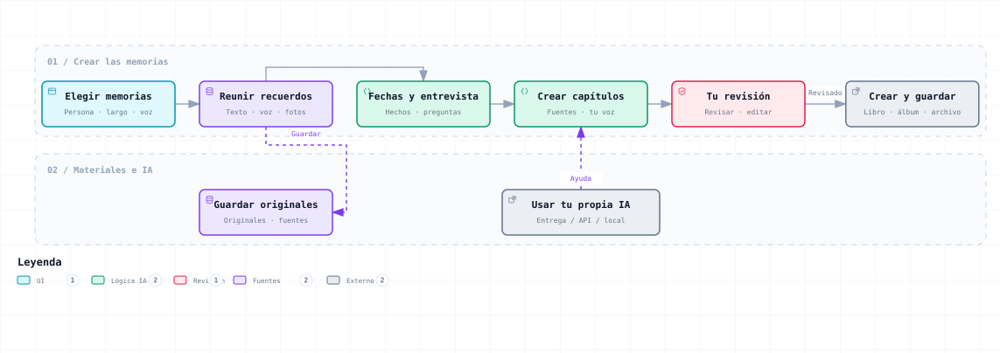

# Memory for Human

[简体中文](../../README.md) · [English](README.en.md) · [Español](README.es.md)

[Repositorio en GitHub](https://github.com/SkyPiggy8/memory-for-human) · [Descargar ZIP](https://github.com/SkyPiggy8/memory-for-human/archive/refs/heads/main.zip)

**Tú cuentas la historia. Tu IA ayuda a ordenarla. Conserva a las personas y los momentos que quieres recordar.**

Nuestra vida se forma con lo que hemos vivido y con lo que está por venir. Memory for Human (MFH) usa la IA para ayudar a conservar recuerdos reales: un encuentro, años compartidos, decisiones importantes y detalles que solo tú recuerdas.

MFH es ahora una **herramienta local de memorias que funciona (v0.2)**. La interfaz, las preguntas, las explicaciones sencillas y las instrucciones para otra IA están en chino, inglés y español. Usa tu propia API Key o la IA con la que ya hablas, sin conectar una API.



El diagrama muestra la dirección general. La transcripción de archivos de audio, el reconocimiento de imágenes y la integración automática con álbumes o NAS siguen pendientes. [Diagrama interactivo (visor en chino)](../overview.html) · [Guía práctica en español](guide.es.md#usage)

## ¿Todo esto es nuevo para ti?

Piensa en un cuaderno con un ayudante. Escribes un recuerdo, respondes a una pregunta o recoges las palabras de un familiar. La IA puede ordenarlas para que se lean mejor, usando solo lo que le das. Revisas el resultado y lo guardas o imprimes.

Solo necesitas uno de dos caminos: **poner tu API Key en la ventana de conexión** o **copiar las instrucciones de “Usar mi propia IA” a la IA que ya utilizas**. Un familiar puede manejar el ordenador mientras una persona mayor cuenta la historia.

“Cómo funciona” explica con palabras cotidianas la herramienta, la Key, cómo usarla sin Key y adónde van los textos. Si está conectada, tu IA puede volver a explicarlo.

## Empezar en tu ordenador

### Windows: abre un solo archivo

1. Descarga y descomprime el repositorio.
2. Haz doble clic en **`start.cmd`**. Si falta un entorno adecuado, descarga y verifica Node.js LTS oficial dentro de esta carpeta, sin instalarlo para todo el sistema como administrador.
3. Se abre la página local en el navegador. Mantén abierta la ventana de inicio; al cerrarla se detiene el servicio.
4. Elige el idioma arriba a la derecha. Empieza unas memorias o prueba el ejemplo, claramente marcado como ficticio.

Dirección habitual: `http://127.0.0.1:4317`. La preparación inicial necesita internet. Después puedes escribir, ordenar y hacer copias sin conexión. Si falla, entrega [la guía para tu IA](AI-HANDOFF.es.md) a una IA que pueda ayudarte con el ordenador.

### macOS / Linux

Pide a tu IA que siga [la guía](AI-HANDOFF.es.md), prepare Node.js 22 o posterior y ejecute `sh start.sh`. Si conoces la terminal, puedes ejecutar:

```sh
node server.mjs
```

También puedes abrir `index.html` directamente para escribir, importar texto, editar y exportar. **El modo de archivo no conecta con APIs.** El archivo y la dirección web local tienen almacenamientos distintos del navegador: descarga una copia antes de cambiar e impórtala después.

## Cuatro pasos para un capítulo

1. **Elegir unas memorias.** Ponles nombre, indica de quién es la historia y para quién, y decide si empiezas con un capítulo o un libro largo.
2. **Contar tu historia.** Responde una pregunta cada vez. Escribe, usa el dictado si el navegador lo permite o importa texto. Las respuestas se pueden editar.
3. **Crear un capítulo.** Usa la IA conectada, reúne tus palabras originales o pega un capítulo de tu IA habitual. Edita, comprueba y marca como revisado.
4. **Guardar y crear.** Descarga la copia completa de los textos o un archivo Markdown, o guarda un PDF desde la impresión del navegador. Sigue la lista para hacer un libro físico.

El trabajo se guarda en el navegador de este dispositivo. Puedes crear varias memorias, cambiar entre ellas y recuperar copias. **El navegador no debe ser tu única copia**: descarga el proyecto y conserva otra copia independiente.

## Tu IA, a tu manera

| Camino | Qué haces | Para qué sirve |
| --- | --- | --- |
| API Key | Eliges el servicio y pones la Key localmente | Probar la conexión, continuar preguntas, escribir, revisar y explicar |
| Tu IA habitual | Copias instrucciones, incluyes materiales si quieres y pegas el resultado | Entrevistas, escritura y revisión manuales |
| IA que usa el ordenador | Le das el repositorio y [AI-HANDOFF.es.md](AI-HANDOFF.es.md) | Iniciar y configurar la aplicación real, y enseñarte a usarla |
| Modelo local | Pones una dirección local compatible y un modelo en las opciones | Procesar texto con un modelo instalado por tu cuenta |

Hay configuraciones para OpenAI, DeepSeek, Claude, Doubao y servicios compatibles. Se pueden cambiar los valores propuestos. Los permisos, el saldo y los modelos dependen de tu cuenta. Los adaptadores se han implementado con documentación oficial y probado con respuestas simuladas; **no se han probado uno por uno con Keys reales de usuarios**. [Fuentes y alcance](../technical.md#api)

Una cuenta de chat y una API son caminos diferentes. Tu IA puede ayudarte con el modelo o la dirección. No pongas una Key real en chats, memorias, paquetes de instrucciones ni repositorios públicos. Por defecto, el servidor local solo la mantiene en memoria durante esta ejecución.

## Seis tipos de memorias

| Tipo | Estructura sugerida |
| --- | --- |
| Historia de amor | Encuentro → cercanía → días juntos → cambios → palabras para tu pareja |
| Matrimonio y familia | Encuentro → decisión compartida → boda → hogar → crecer juntos |
| Historia de una vida | Infancia → estudios → trabajo → familia → cambios → últimos años → descendientes |
| Compañeros de servicio | Encuentro → vida compartida → experiencias → despedida → contacto posterior |
| Compañeros de trabajo | Llegada → colaboración → momentos clave → aprendizaje → despedida |
| Amigos de la escuela | Llegada → rutina → recuerdos de grupo → graduación → reencuentro |

Las plantillas chinas sugieren unos 3.000–15.000 caracteres para una historia de amor y 30.000–80.000 para una vida. Son referencias opcionales en chino, no cuotas equivalentes de palabras en español. Ajusta la longitud a los recuerdos reales.

Una vida extensa puede organizarse en unos 10–16 capítulos. Habla de un tema cada vez y descansa cuando haga falta. Ya puedes guardar varios capítulos y continuar después; no se inventa una vida entera con un clic. Empieza con una historia breve o un capítulo de vida.

## Añadir materiales

- Responde directamente, con ayuda de un familiar si hace falta.
- Importa texto UTF-8 `.txt`, `.md`, `.csv` o `.json`, hasta 1 MB por archivo. Se lee texto, no se adapta cualquier plataforma de chat automáticamente.
- Transcribe antes las grabaciones con tu herramienta y revisa las palabras. El dictado depende del navegador y puede usar internet; no es transcripción de archivos de audio.
- Escribe pies de foto con personas, fecha, lugar e historia. Guarda los originales aparte. No se reconocen imágenes, PDF ni escritura a mano.
- Importa un `.mfh.json` creado por el botón de copia completa. Se crean unas memorias nuevas sin sustituir las anteriores.

Los materiales nuevos **no se envían a la IA por defecto**: selecciónalos individualmente. También puedes elegir o excluir respuestas para cada capítulo. Las tareas usan respuestas y materiales seleccionados y el capítulo necesario. Si hay demasiado contexto, se pide dividirlo; no se descarta en silencio. [Guía práctica](guide.es.md#usage)

## Veracidad y privacidad

La IA ayuda a expresar experiencias reales, no a inventarlas. Los borradores conservan referencias como `[A1]` para respuestas y `[M1]` para materiales. Quien cuenta la historia decide la versión final. Editar un capítulo revisado lo vuelve a marcar como borrador.

Una página local no significa que todo sea sin conexión. Las peticiones a una API o a una IA en línea envían el texto seleccionado a ese servicio. Pide permiso para recoger entrevistas, chats, fotos y compartirlos.

La copia completa de textos contiene respuestas, textos importados, borradores y una respuesta sin terminar. Excluye la API Key y las fotos o grabaciones originales. Guarda esos originales por separado.

## Crear algo que puedas conservar

| Resultado | Un camino sencillo |
| --- | --- |
| Libro impreso | Revisar → descargar → consultar especificaciones → preparar PDF → un ejemplar de prueba → corregir y encuadernar |
| Libro de fotos | Elegir originales → añadir descripciones reales → maquetar → revisar recortes → probar |
| Álbum digital / marco | Probar fotos y tarjetas de historias en una tableta antes de comprar equipos |
| Archivo familiar / NAS | Material local y copias independientes; añadir NAS cuando sea útil y probar la recuperación |

[La guía en español](guide.es.md#usage) explica materiales, impresión, privacidad y herramientas opcionales. Los proyectos independientes se enlazan, no se integran automáticamente.

## Entregar el trabajo a otra IA

“Usar mi propia IA” genera instrucciones para la tarea y el idioma. Los materiales privados solo se incluyen si lo eliges. Copia o descarga el paquete y pega después el capítulo como texto o el JSON indicado.

Guías del repositorio: [chino](../ai-handoff.md#handoff), [inglés](AI-HANDOFF.en.md), [español](AI-HANDOFF.es.md). [AGENTS.md](../../AGENTS.md) describe los archivos, el inicio, las verificaciones y los límites para asistentes de programación.

## El trabajo técnico

MFH se centra en **fuentes consultables, tareas independientes del modelo, revisión humana y progreso recuperable**. Respuestas y materiales tienen identificadores estables; las peticiones usan solo fuentes elegidas. La entrega manual y la API comparten reglas. Editar un capítulo revisado lo devuelve a borrador; recuperar una copia crea un proyecto nuevo.

La interfaz sin compilación y el servidor con módulos incluidos en Node.js reducen dependencias y separan la Key de la obra. Seis relaciones, tres idiomas, ayuda de familiares y pasos de producción conectan entrevista y recuerdo terminado. El [diseño técnico](guide.es.md#architecture) explica datos, alcance de peticiones, revisión y límites de obras largas.

StorySage trabaja con agentes especializados; memoir con registros y gestión del contexto. MFH facilita que una familia empiece con su propia IA y conserve una obra que pueda continuar. Comparten algunos principios; la diferencia de MFH está en su combinación y público. [Referencias y diferencias](guide.es.md#related-work)

Cada idioma tiene **156 preguntas iniciales**: pareja 24, matrimonio 24, una vida 48, servicio 20, trabajo 20 y estudios 20. La IA sigue detalles concretos antes de cambiar de tema, con una pregunta cada vez. [Guía de entrevista](guide.es.md#interview)

## Qué funciona y qué falta

**Funciona:** interfaz y preguntas en tres idiomas, explicaciones sencillas, instrucciones para otra IA, seis temas, texto, dictado compatible, varias memorias, guardado local, edición, adaptadores de API, copia y recuperación, Markdown e impresión.

**Pendiente:** transcribir audios subidos, OCR e imágenes, importación de chats específicos, maquetación ilustrada automática, integración con álbumes/NAS, búsqueda en libros largos y revisión de versiones entre autores.

No hay dependencias de interfaz que instalar. El servidor usa funciones incluidas en Node.js. Verificación para desarrolladores: `npm test`.

## Licencia

[PolyForm Noncommercial 1.0.0](../../LICENSE) permite el uso, la modificación y la distribución para fines autorizados por la licencia, y restringe el uso comercial no autorizado. Tus materiales y obras privadas no tienen que publicarse. Las herramientas externas mantienen sus propios términos; consulta [THIRD_PARTY_NOTICES.md](../THIRD_PARTY_NOTICES.md) para el visor del diagrama y otros contenidos de terceros.
